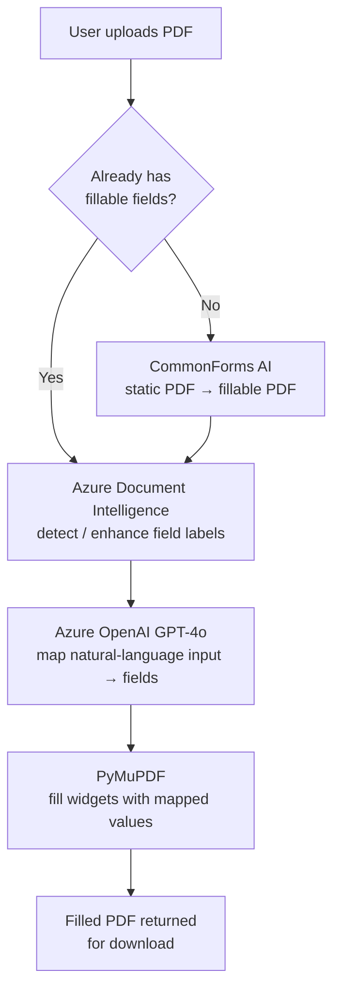
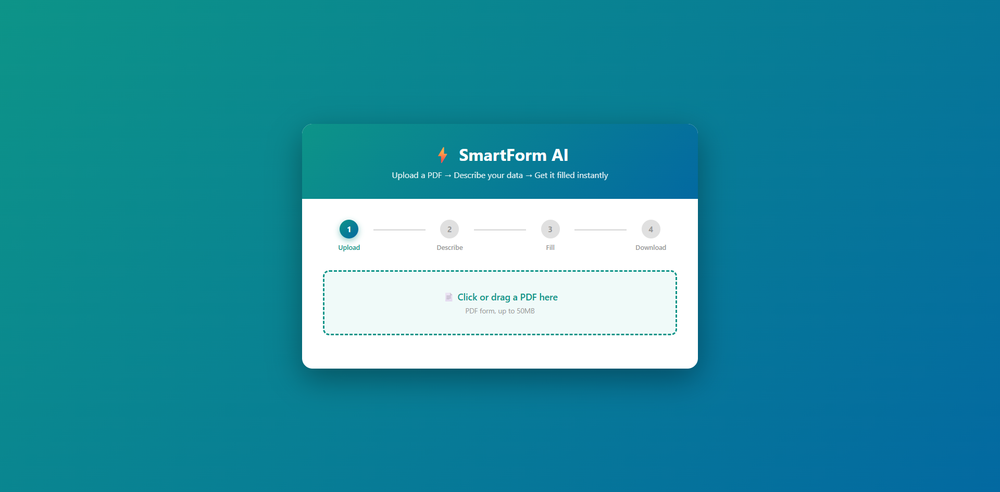
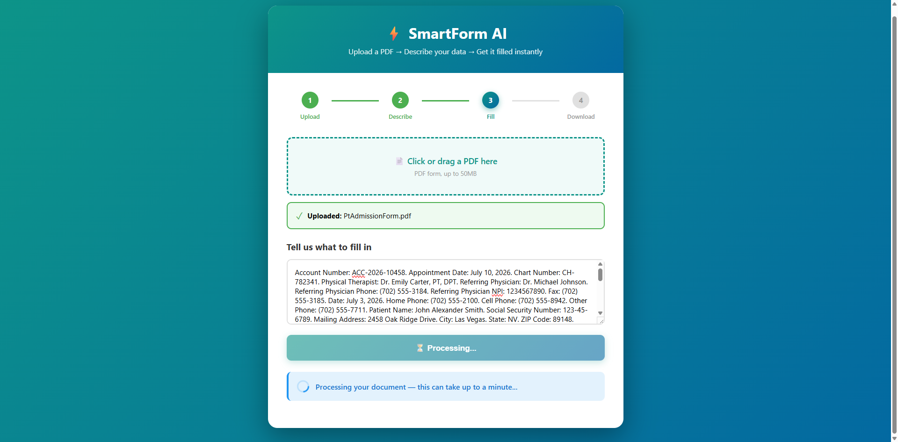
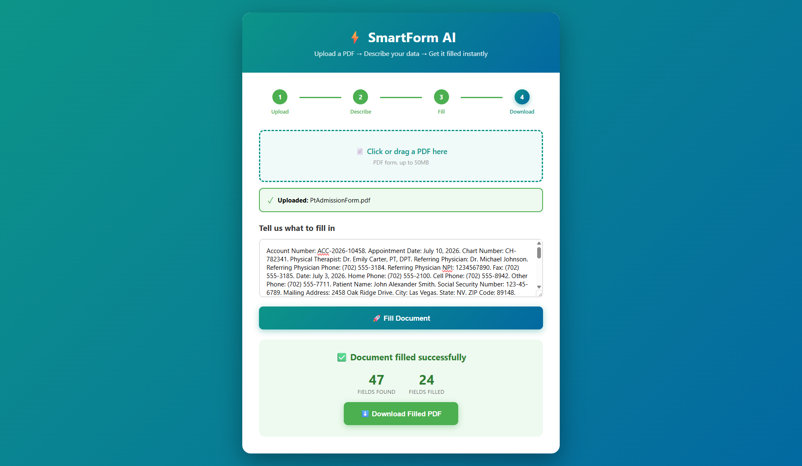

# SmartForm AI — PDF Demo (POC)

Stripped-down build of the main app: PDF upload + fill only. No DOCX support, no extra API routes, single-page UI.

**Tech stack:** Python, Flask, Azure Document Intelligence, Azure OpenAI (GPT-4o), PyMuPDF, CommonForms AI, pdf2image.

## What is this?

SmartForm AI takes any PDF form — filled-in fields or not, scanned or typed — and fills it automatically from a plain-English description of the data ("Name: John Smith, DOB: 01/15/1990, ..."). No manual field mapping, no template setup per form.

It solves three problems that make PDF automation hard in practice:

1. **Most downloaded PDF forms aren't actually fillable** — they just look like forms (lines, boxes, underscores) but have no real form widgets. **CommonForms AI** converts these static PDFs into real fillable PDFs first.
2. **Field labels are messy or ambiguous** once a form is fillable — a widget might be named `field_12` with no indication it means "Date of Birth". **Azure Document Intelligence** reads the surrounding layout/text to attach a real label to every field.
3. **User input rarely matches field names 1:1** — people describe data in free text, not as a key/value form. **Azure OpenAI (GPT-4o)** semantically maps the user's natural-language input onto the correct extracted fields, handling synonyms, abbreviations, and reordering.

The result is filled back into the original PDF using **PyMuPDF**, preserving the form's layout, and served back for download.

This `demo/` build exists to show that pipeline end-to-end with the smallest possible surface area — one file type, one workflow, no auxiliary/debug endpoints — so it's easy to follow in a walkthrough.

## Setup

```bash
cd demo
pip install -r requirements.txt
cp .env.example .env   # fill in Azure DI + Azure OpenAI credentials
python app.py
```

Open `http://localhost:5000`.

## Architecture

```
Browser (templates/index.html)
   │  1. POST /api/upload            (PDF file)
   ▼
Flask app.py
   │  2. POST /api/process-and-fill  (filepath + natural-language data)
   ▼
┌───────────────────────────────────────────────────────────────────┐
│                   Sequential pipeline (strict order)               │
│                                                                     │
│  Step 1  CommonForms AI                                            │
│          static PDF → fillable PDF (skipped if already fillable)   │
│                          │                                         │
│  Step 2  Azure Document Intelligence                                │
│          detect / enhance form fields on the fillable PDF          │
│                          │                                         │
│  Step 3  Azure OpenAI (GPT-4o)                                     │
│          map user's natural-language data → extracted fields       │
│                          │                                         │
│  Step 4  PDF fill (PyMuPDF)                                        │
│          write mapped values into the PDF's form widgets           │
└───────────────────────────────────────────────────────────────────┘
   │  3. JSON response (field counts + output filename)
   ▼
Browser
   │  4. GET /api/download/<filename>
   ▼
Filled PDF
```

`production_document_filler.py` orchestrates steps 1-4 via `pdf_field_handler.py` (Azure DI + GPT-4o + PyMuPDF calls) and `pdf_quality_analyzer.py` (picks CommonForms confidence/resolution settings). Each step validates its output before the next one runs; a failure short-circuits with an error JSON back to the browser.

### AI pipeline 



## Try it

Use `SampleForm.pdf` (included in this folder) to test the pipeline end-to-end without hunting for your own PDF.

## What's here

- `app.py` — Flask app, 5 routes: `/`, `/api/upload`, `/api/convert-pdf`, `/api/process-and-fill`, `/api/download/<filename>`, `/api/health`
- `production_document_filler.py` — PDF-only orchestrator (DOCX branch removed)
- `pdf_field_handler.py`, `pdf_quality_analyzer.py`, `logger.py` — unchanged from main app
- `templates/index.html` — single upload-and-fill page (DOCX buttons/branches removed)
- `SampleForm.pdf` — sample PDF for quick testing
- `images/` — walkthrough screenshots (below)

Pipeline: upload → CommonForms (if not already fillable) → Azure Document Intelligence extraction → GPT-4o field mapping → fill → download.

Requires Poppler on PATH (for `pdf2image`) and a `commonforms` CLI install, same as the main app.

## Walkthrough

**Step 1 — Upload a PDF**


**Step 2 — Describe the data to fill in**


**Step 3 — Processing**


**Before fill**


**After fill**


## Skills demonstrated

- Multi-step AI pipeline orchestration (CommonForms → Azure DI → GPT-4o → PyMuPDF), each stage validated before next runs
- Azure cloud service integration (Document Intelligence, OpenAI)
- Prompt engineering for structured field-mapping (natural language → key/value)
- PDF binary manipulation (form widget detection/fill, quality analysis, static→fillable conversion)
- Flask REST API design, env-based config, logging

## Limitations (POC scope)

- PDF only, no DOCX
- No auth, no persistent DB — files handled on local disk per request
- Single-user / demo-scale, not load-tested
- Requires Poppler + CommonForms CLI installed on host, no containerized deploy yet

## License

MIT — personal portfolio/demo project.

## Author

karthigamuthuraj
Email: karthiga.aaru09@gmail.com
GitHub: https://github.com/karthigamuthuraj
